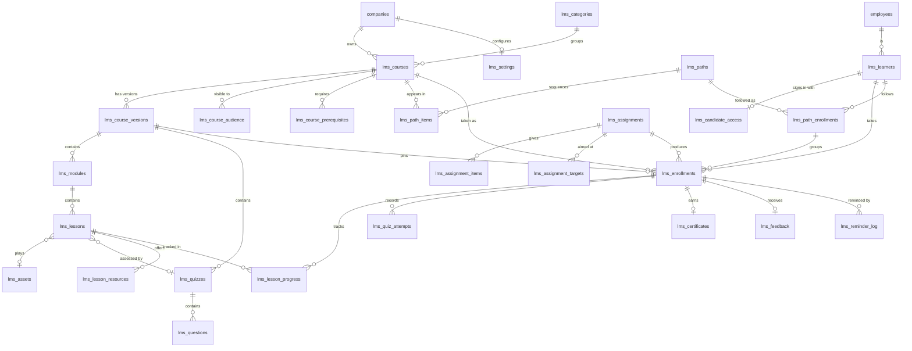

# EZER Learn: product and technical blueprint

For engineers and product owners working on the module. Research behind these decisions is
in [research/](research/). Where a line says *(research)*, the evidence and links are there;
where it says *(decision)*, it is a judgement made for this product.

## 1. What the existing system dictated

These findings from the codebase shaped everything below.

| Finding | Consequence |
|---|---|
| ESS employees are not Supabase auth users. Sessions are HMAC tokens (`lib/ess-session.ts`), so `auth.uid()` identifies nobody | RLS cannot express "this employee's own row". The API is the security boundary, as in EZER Sign (migration 174) |
| Many older tables use allow-all RLS, which `CLAUDE.md` still describes | Not followed. These tables hold assessment results and quiz answers, so they follow the stricter EZER Sign pattern: RLS on, no policy |
| Access is `role_permissions` (module + NONE/VIEW/EDIT/FULL), edited in Roles → Module Access | Permissions are added as three modules, so HR configures them on a screen they already know, with no new permission system |
| Multi-company groups: `grant.crossCompany`, `companyFilter()`, per-role company scope (`ess_user_roles.company_ids`, migration 203) | Every record has a `company_id`. Reads and writes pass through one scope check |
| No `designations` table; designation, grade, team and employment type are text on `employees` | Audience targets match text case-insensitively. `team_name` and `employee_category` are nearly empty today, so those targets exist but will rarely be useful until HR fills them |
| `employee_trainings` and `employee_certifications` already feed Profile 360; `skills` is an existing master | A completion also writes to both, so the profile shows it. Course skills use the `skills` list |
| `ess_notifications` plus `notify()`, and Gmail SMTP with a daily limit | Bell rows are written in bulk. Email is one daily digest per person, except small assignments |
| Onboarding becomes an employee in one place, `createEmployeeFromOnboarding` | One best-effort hook there, backed by a daily sweep, carries candidates over |
| `candidates` (recruitment) and `onboarding_candidates` are separate | The preboarding list merges both |
| Vercel request bodies stop at 4.5 MB | Files never pass through an API route |

**Integration risks.** The live schema was read from PostgREST metadata; `employees` has over
200 columns, and the verify script confirms the nine the engine reads. Migration numbers
206–208 were free on every branch at build time. Adding to `MODULES` changes a list other
screens read, and the existing role tests were run against it.

## 2. Features

Delivered in this release. Deferred items, with reasons, are in
[FEATURE-DECISIONS.md](FEATURE-DECISIONS.md).

**Content.** Course → module → lesson. Lesson types: video, audio, PDF document, slides (as
PDF), article, external link, assessment. Downloadable resources on any lesson. Categories,
tags, skills, difficulty, duration, language, thumbnails.

**Assessment.** Single choice, multi-select with optional partial credit, true/false, and
auto-graded short text. Pass mark, marks per question, attempt limit, cooldown between
attempts, time limit enforced by the server, random draw of N from a pool, shuffled questions
and options, show-answers policy, Excel import. Optional or required per lesson. A final
assessment that can be the only completion rule.

**Video.** Resume, rewatch, a configurable share that must be watched, optional blocking of
skipping ahead, speed control. Duration and poster captured in the browser. Coverage credited
on the server and capped by the wall clock.

**Completion.** All required lessons, a percentage of them, or the final alone. Optional
extra conditions: all quizzes passed, final passed, a minimum overall score. Sequential,
module-sequential or free order. Prerequisites. Drip release by module. Attestation
("I have read and understood").

**Lifecycle.** Draft → optional review → published → archived. Scheduled publish and
retirement. Immutable published versions. Choice of whether mid-course learners move to a new
version, carrying their progress. Copy a course to another company in the group.

**Assignment.** Individuals, bulk, company, department, designation, location, team, grade,
employment type, employee category, confirmation status, a manager's reports, and exclusions,
with a live audience preview. Snapshot or keep-applying. Fixed or relative due dates, priority,
reminder frequency, scheduled start, retake. Excel import that applies nothing unless every
row is valid.

**Automation.** Onboarding templates that fire on joining, with due dates from the joining
date and staged per-course offsets. Dynamic assignments. Preboarding templates. Recertification
by validity period. Leavers' open training closed.

**Preboarding.** A personal link and email code, a limited portal, conversion into the
employee record with nothing lost.

**Catalogue.** Published courses can stay unassigned. Visibility per course: everyone,
restricted audience, or hidden. Self-enrolment, manager approval, or assignment only. Search,
filters, simple explained recommendations, ratings and reviews.

**Learning paths.** Sequential or flexible programmes, assigned or self-enrolled, tracked as
one, with their own certificate.

**Employee portal.** My Learning, Catalogue, Achievements, Team for managers. Works in a phone
browser. Certificates with a public verification page.

**Oversight.** HR dashboard, department and course breakdowns, compliance, overdue, failed
assessments, assessment analytics, filters, Excel export, manager team view, an append-only
audit log.

**Reminders.** In-app and email: before the due date, repeating when overdue, then escalation
to the manager. One digest per person per day.

## 3. Content hierarchy

```
Category → Course → Version → Module → Lesson → (quiz, resources)
Learning path → Courses
```

The question was whether Course → Module → Lesson → Video/Quiz is right, or something more
flexible.

**Decision: a lesson holds one primary piece of content, and a quiz attaches to it.** Most
products treat a quiz as a sibling lesson after the video *(research)*. That works but forces
authors to build two objects and keep them in order, and the brief's central case is "this
video, then its quiz". So a quiz is an optional attachment on any lesson, gated on the content
being finished. A standalone test is simply an `ASSESSMENT` lesson with no content. This gives
the same flexibility with less to do. A quiz inside the video timeline is not supported: only
Workday was verified doing this *(research)*.

**Modules are mandatory in the data and invisible in effect.** A short course has one module.
The brief's "topic" is a lesson.

**Versions sit between course and content.** A course is the stable identity (code,
catalogue entry, reports across years). What a learner studies is a version. Mature products
decide what happens per learner status *(research)*, and so does this: see section 7.

**A path is separate from a course.** A course teaches and a path sequences, and a named
bundle above the course exists in nearly every product *(research)*. Each course in a path keeps
its own enrolment, score and certificate, so a course taken inside a path counts everywhere.

## 4. Roles

The brief named nine possible roles. The minimum that covers real work is below. Self-paced
delivery needs no instructor *(research)*, so none exists.

| Role | Source | Purpose |
|---|---|---|
| Super Admin | existing | Everything, across companies |
| HR Head, CHRO, Admin (Company) | existing | Owns learning for the company |
| **L&D Manager** | **new** | Owns learning with no wider HR access |
| HR Manager | existing | Builds courses and runs all assignment; HR Head signs off publishing |
| **Content Author** | **new** | Builds courses. Cannot publish or assign |
| **Training Coordinator** | **new** | Assigns and chases. Cannot change content |
| HR Executive, Branch HR | existing | Assign and follow up. Branch HR sees one branch |
| Department Head, Manager | org structure | Own team only. Needs no role, because it comes from the reporting line |
| Employee | everyone | Their own learning |
| Candidate | no role | One link, assigned courses only |

Author and assigner being separate powers, with scope separate from role, is the most
consistent pattern across products *(research)*. Department Head is deliberately not a content
role: give a head the Content Author role if they author.

Permission is three modules, because a single module with three levels cannot keep content and
assignment independent.

### Permission matrix

Set in Roles → Module Access. These are defaults; HR can change any cell, and can create
custom roles.

| Role | Learning Content | Learning Assignment | Learning Reports |
|---|---|---|---|
| Super Admin | FULL | FULL | VIEW+ (all) |
| All Access, Admin (Company), CHRO, HR Head, L&D Manager | FULL | FULL | VIEW |
| HR Manager | EDIT | FULL | VIEW |
| Implementation Manager | EDIT | EDIT | VIEW |
| HR Executive, Branch HR, Training Coordinator | VIEW | EDIT | VIEW |
| Content Author | EDIT | none | none |
| MD | none | none | VIEW |
| Employee, Manager, Department Head | none | none | none |

What each level allows:

| Action | Needs |
|---|---|
| See every course, drafts included | Content VIEW |
| Create and edit courses, upload files, build quizzes, draft paths, submit for review | Content EDIT |
| Publish, schedule, review, archive, restore, publish paths | Content FULL |
| Categories, LMS settings, revoke a certificate | Content FULL |
| See assignments and candidates | Assignment VIEW |
| Assign to people and groups, invite candidates, extend, waive, grant attempts, reassign, import Excel | Assignment EDIT |
| Assign to the whole company, keep-applying rules, onboarding and preboarding templates | Assignment FULL |
| Dashboards, reports, exports, certificates list | Reports VIEW |
| Take courses, catalogue, achievements | Every employee |
| Team view, approve course requests, assign to own reports | Anyone with reports, or a Department Head. Assigning can be switched off per company |

**Scope.** A person's Learning roles decide reach: their company, the companies a role was
extended to, or all for a cross-company role. If every role granting Learning is branch-scoped,
as Branch HR is, they see and assign within their own location only. Their audiences are
ANDed to it, so "Sales" means "Sales in my branch".

HR Executive's existing scope is `DEPT`, which would limit them to the HR department and make
them useless here, so department scope is not applied to Learning *(decision)*.

## 5. Workflows

**Build and publish.** Author creates a course, adds modules and lessons, uploads files, adds
quizzes, sets rules. The publish panel lists anything that blocks going live, in words. If the
company requires review, the author submits, and someone else must publish.

**Assign.** Pick courses or paths, pick an audience, see the count, set due date and priority,
send. Enrolment happens in one transaction. People get a bell at once, and email if 25 or
fewer were enrolled, otherwise in the next daily digest.

**Learn.** Employee opens Learning. Watches, and the server credits coverage. The quiz opens
at the threshold. A pass completes the lesson and the next unlocks. On completion the
certificate is issued and the result appears on their profile.

**Fail and retry.** Attempts count when a paper is opened, not when submitted, or a paper could
be read and abandoned for free. Out of attempts, one of two configured outcomes applies. *Lock*:
the enrolment is FAILED and appears in HR's report, and HR grants an attempt or reassigns.
*Rewatch*: the learner returns to the video, and watching it again earns the attempts back.

**New joiner.** Daily, and at employee creation, every active onboarding template matching the
person enrols them, with due dates counted from their joining date. Long-serving staff are
untouched: rules look back only `join_window_days`.

**Preboarding.** HR invites from the list of upcoming joiners, or a template does so. The
candidate opens the link, enters an emailed code, and sees assigned courses only. When the
employee record is created the same learner row becomes theirs, the link stops working, and
onboarding courses follow, skipping anything already finished.

**Recertification.** A course with a validity period sets an expiry on completion. A set
number of days before it, a new cycle opens, due on the expiry date. The old record stays. An
unrenewed completion becomes EXPIRED and stops counting. This follows the common pattern of
recurrence hanging off completion rather than a calendar job *(research)*.

**Request approval.** Employee requests an approval-mode course, their manager approves or
declines in Team. An assignment arriving meanwhile supersedes the request.

## 6. Navigation

**HR (`/dashboard/learning`, under People, and inside ESS).** One screen, with tabs following
the person's permissions: Overview · Courses · Learning Paths · Assignments · Automation ·
Preboarding · Reports · Certificates · Settings · Audit log.

**Employee (`/ess/learning`, under You & your team).** My Learning · Catalogue · My
Achievements · Team (only with reports). Course player inside.

**Candidate (`/learn/<token>`).** Sign-in, then their learning and the player. No ESS shell.

**Public (`/learn/verify/<code>`).** Confirms a certificate.

## 7. Versioning

| Learner on publish | What happens | Why |
|---|---|---|
| Not started | Moves to the new version | They lose nothing |
| In progress | Stays, unless the publisher ticks "move them too" | Changing a course under someone is a bigger surprise than an old version |
| Completed | Keeps the record against the version they took | That is what they were certified on |

Most products restart a learner they move *(research)*. Here each cloned lesson remembers its
source, so progress follows them, through several versions if needed. Quiz attempts stay as
history. The database refuses edits to a published version, so a bug cannot rewrite what someone
was certified on. Titles and catalogue fields live on the course and may change freely.

## 8. Database

27 tables, all `lms_`. Full definitions with comments are in migration 206.



Also: `lms_audit_log`, which is append-only and tied to nothing, so it outlives what it records.

Decisions worth knowing:

**One learner table.** `lms_learners` has one row per person, employee or candidate, and every
record hangs off it. Conversion sets `employee_id` on one row, and nothing else has to be
rewritten. The alternative, nullable employee and candidate columns on every table, makes
conversion a multi-table rewrite. It is unique per company rather than globally, so a group
transfer starts a new record in the new legal entity, and Achievements reads across both.

**Assignments are instructions, enrolments are results.** The audience is stored as rules, so a
company-wide assignment is one row and one target rather than 2,000 rows, and it records who
asked for what. Assignment being a rule rather than a list is close to universal *(research)*.

**Snapshot or dynamic is a per-assignment choice.** `ONCE` takes who matches today, `DYNAMIC`
adds later matches, `ON_JOIN` and `PREBOARD` are templates. Someone who leaves the audience
keeps their enrolment: unassigning people because a department field changed would surprise
HR, as rule engines elsewhere do *(research)*. Each assignment enrols a person in a course at
most once, so someone HR removed is not re-enrolled overnight.

**History is never overwritten.** A retake or renewal is a new row with the next `cycle_no`,
which is the norm *(research)*. A partial unique index allows one open enrolment per person per
course, which also makes every bulk insert safely repeatable.

**Progress** is stored per lesson in `lms_lesson_progress`. `lms_enrollments.progress_pct` is
the share of required lessons done, recomputed from it on each lesson event by one function,
the only writer of enrolment status.

**Scale.** Audience matching and enrolment are set-based SQL in one transaction, so a 2,000-person
assignment needs no looping in a serverless function. Dashboards are aggregates returned as one
JSON value, because PostgREST caps row results at 1,000.

## 9. Architecture

```
Browser                                Server (Vercel, bom1)                 Supabase (Mumbai)
────────                               ─────────────────────                 ─────────────────
HR workspace ──┐                       /api/lms/admin/*  → access.ts ─┐
Employee hub ──┼─ Bearer ESS token  →  /api/lms/me/*     → learner.ts ┼─ service role → Postgres (RLS: no policy)
Manager team ──┘                       /api/lms/team     → reporting line                 lms_* tables, functions
Candidate ───── Bearer candidate token → /api/lms/me/* only
Public ─────────────────────────────→  /api/lms/verify, /api/lms/pre
Browser ──── signed token, TUS, 6 MB chunks ──────────────────────────────→ Storage: lms-content (private)
<video> ──── shared signed URL, Range ────────────────────────────────────→ Smart CDN
Vercel cron 06:00 IST → /api/cron/lms-daily
```

The split between code and SQL follows one test. What a person experiences is a pure function
in `lib/lms/core.ts`, covered by unit tests. Work across thousands of rows is SQL in migration
207. The two meet only at the tables.

## 10. Video

Full comparison and arithmetic: [research/video-delivery.md](research/video-delivery.md).

| Option | 500 staff, 40 six-minute videos, evenly spread | All viewed in one month |
|---|---|---|
| **Supabase Pro, cached** | **$0** extra | $78.90 |
| Supabase Pro, uncached | $0 extra | $236.70 |
| Cloudflare R2 | $0 | $0 |
| S3 + CloudFront | $0.12 | $202.42 |
| Mux, 720p | $0.58 | $35.78 |
| Bunny Stream | $7.30 | $86.50 |
| Cloudflare Stream | $17 | $149 |

Based on 240 GB a month. Figures are list prices read on 1 November 2026, before GST.

**Decision: Supabase Storage, no new vendor.** The project is already there, and it costs
nothing extra for one customer of this size.

- **Uploads** go directly from browser to a private bucket by TUS through a signed token, in the
  6 MB chunks Supabase requires. They resume after a dropped connection.
- **Format** is MP4, H.264 and AAC, with the index first. Nothing transcodes, so this is checked in
  the browser by reading the file's structure, and refused with instructions. The usual offender
  is an iPhone recording in HEVC, which plays on the author's Mac and not on an employee's PC.
- **Playback** is a plain `<video>` with Range requests.
- **One shared signed URL per file, reissued daily.** The CDN keys on the full URL, so per-viewer
  tokens would never hit cache and every play would bill as uncached egress. The cost is that a
  copied URL works for up to a day. It is only handed to entitled learners, and videos are
  training content. Documents, which are small, get 15-minute per-request URLs. If a customer
  needs stricter protection, that is one of the triggers below.
- **`lms_assets.provider`** is the seam for moving later. A lesson references an asset, not a
  file, so switching provider changes `mediaUrl()` and not the course model.

**Limits to accept.** A single MP4 has no lower-quality fallback, so a very slow connection
stalls rather than downgrading. Video and the HRMS share one egress quota. Quotas are per
organisation: the $0 holds for one customer, and five of this size need about 1,200 GB a month.

**Move to Mux capped at 720p, with Bunny Stream as fallback, when any one is true** (thresholds
are judgement): over 1 TB of video egress for two months running; one customer's mandatory month
exceeds 1 TB (about 174 employees on this library); a low-bandwidth workforce, or over 3% of
plays stalling; a customer needs DRM; or `supabase.co` is blocked again in India. This needs
approval because it is a paid service. Test Mux on Jio and Airtel for a day first, because its
India coverage could not be verified.

**Completion tracking.** The client sends the ranges it played every 15 seconds. The server is the
only place credit is granted:

```
credit = min(new unique seconds claimed, seconds since last beat × 2 + 5)
```

Duration comes from the stored asset, not the request. Coverage is unique seconds, so scrubbing
earns nothing and rewatching costs nothing. Parallel tabs share one budget. A forged client can
only finish as fast as a person at double speed, so cheating saves little.

Say this plainly to buyers: this proves a player ran for long enough, not that anyone paid
attention. No system can prove that *(research)*. For compliance content, add a quiz and an
attestation, because those are the evidence. Blocking skip-ahead is a usability control, not
security.

**SCORM** is not built. Value is real only once a customer brings a purchased library. Supabase
serves HTML as plain text, so unzipped packages cannot be hosted in a bucket as they are, and the
build is weeks. Add SCORM 1.2 import on the first paying request.

## 11. Security

**Defence in depth, from the outside in.**

1. **No browser access to data.** RLS on, no policies, `REVOKE ALL` from `anon` and
   `authenticated`. The anon key every browser holds reads and writes nothing.
2. **No browser access to functions.** Postgres grants `EXECUTE` to `PUBLIC` by default and PostgREST
   exposes every public function, so `lms_enrol_learners` would otherwise be callable by anyone.
   All are revoked. A test checks this.
3. **Private bucket, no storage policies.** Files are reachable only through signed URLs minted
   after an entitlement check.
4. **Every route authenticates, then authorises.** `lmsAdmin(req, cap)` or `lmsLearner(req)`.
   Identity comes from the signed token, never a parameter.
5. **Tenant isolation twice.** Routes pin to a company. Composite foreign keys such as
   `(course_id, company_id)` mean the database refuses a row linking two tenants, even from a buggy
   route. Another company's id answers 404, so ids reveal nothing.
6. **Learner isolation.** Enrolments are fetched by learner, so another person's id is a 404.
   Lessons are checked for locks on every action, so a locked lesson's id is no way in.
7. **Answer keys never leave the server** before submission. The learner's paper is built field by
   field, so a new column cannot leak by default. Grading reads the stored key and a snapshot of
   what the learner saw.
8. **Time is the server's.** Quiz limits, video credit and dwell time use server clocks.
9. **Immutability and audit.** Triggers freeze published versions and make the audit log append-only.

**Candidates.** Their token has a distinct prefix and an HMAC key derived for this purpose alone.
The ESS verifier accepts anything signed with the ESS secret and treats `sub` as an employee, so a
candidate token signed the same way would have reached ESS routes. Only `lmsLearner` accepts these
tokens. The link is stored as a SHA-256 hash. The code is an HMAC bound to the learner, single-use,
10 minutes, 5 tries, 8 sends per link. Revoking, reissuing or joining bumps `session_version`, which
ends every session at once.

**View as.** An admin viewing someone's portal may read, and every write is refused, so nobody can
sit someone else's assessment.

**Exports.** Excel cells beginning with `=`, `+`, `-` or `@` are escaped, because names and titles
are typed by people and would otherwise run as formulas. Article text renders as text, never HTML.

**Personal data.** Lookups return names and org fields only. Public verification shows name, title,
company and dates, and no employee code, department or email.

**Known limits.** Authorisation sits in the API layer, so a future route that forgets `lmsAdmin`
would be open, as with the rest of the app; the deny-all RLS means the anon key still gets nothing,
but the service role bypasses it. The daily-rotated video URL is shareable for a day. Client-side
seek blocking can be bypassed, which the server credit makes harmless.

## 12. Phases

| Phase | Scope | Status |
|---|---|---|
| 1 | Everything in section 2 | This release |
| 2 | Shared question bank, certificate template designer, training calendar, Today widget, auto-unassign on audience change, native mobile screens | Next |
| 3 | SCORM 1.2 import, streaming provider, training costs, external training records, gamification | On demand |

**Mobile.** All ten products ship a native app *(research)*, so it will be expected eventually. The
Expo app is on a separate branch that is not merged, so screens could not be added here without
coupling this branch to it. The learner screens work in a phone browser now. Native screens are
Phase 2 and can reuse `lib/lms/core.ts` and these APIs.

## 13. Testing

| Layer | What | Where |
|---|---|---|
| Rules | Locks, credit, grading, completion, papers, publish checks, dates | `lib/lms/__tests__/core.test.ts` |
| Security units | Token separation, tampering, permissions | `candidate-session.test.ts`, `caps.test.ts` |
| Format | MP4 checks, including reading a 2 GB file's structure without reading it all | `mp4-check.test.ts` |
| Database | PASS/FAIL after migrating, safe on live data | `supabase/verify/208_lms_verify.sql` |
| End to end | The 17 brief scenarios plus attacks, through real routes | `scripts/lms-e2e/` |
| Screens | Real browser, each role, 1280 px and 390 px | Reported in IMPLEMENTATION-REPORT.md |

The end-to-end rig runs the real Next.js app against real Postgres semantics (PGlite) and a local
stand-in for PostgREST, Storage and TUS, with invented people only. It keeps PostgREST's 1,000-row
cap, so a truncating query fails there too. It cannot prove behaviour specific to Supabase, which is
why SETUP.md has a 15-minute live check.
